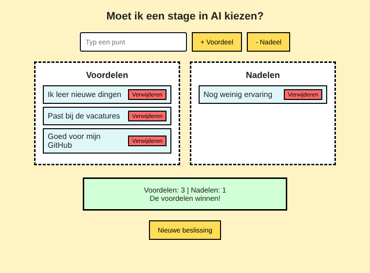

# UDecideWise

Een hulpmiddel om een beslissing te nemen. Je typt waar je over twijfelt, zet de voordelen en nadelen op een rij, en de app laat zien welke kant wint.

Gemaakt in mijn eerste jaar Software Developer aan het Grafisch Lyceum Rotterdam.

**Live demo:** https://udecidewise.netlify.app

## Functies

- Een onderwerp invullen, bijvoorbeeld "Moet ik React leren?" (starten kan ook met Enter)
- Punten toevoegen als voordeel of als nadeel
- Punten weer verwijderen
- Een scorebord dat telt hoeveel voordelen en nadelen er zijn, en laat zien of de voordelen of de nadelen winnen, of dat het gelijkspel is
- Opnieuw beginnen met een nieuwe beslissing

## Hoe het werkt

Er is geen database. Alles gebeurt in de browser met JavaScript:

- `submitTopic()` verbergt het startscherm en laat de lijsten zien.
- `renderItem()` maakt voor elk punt een `<li>` met een verwijderknop.
- `updateScore()` telt hoeveel `<li>`-elementen er in elke lijst staan en past het scorebord aan.

## Gebruikte technieken

- HTML
- CSS (flexbox)
- JavaScript (functies, DOM-elementen maken en verwijderen, event listeners)

## Wat ik heb geleerd

- Elementen aanmaken met `createElement` en verwijderen met `remove()`
- Delen van de pagina tonen en verbergen met `style.display`
- Tellen hoeveel elementen er in een lijst staan met `children.length`
- Tekst veilig toevoegen met `textContent`, zodat ingevoerde HTML niet wordt uitgevoerd

## Zelf uitproberen

Download de bestanden en open `index.html` in je browser. Er hoeft niets geïnstalleerd te worden.

## Mogelijke uitbreidingen

- Elk punt een gewicht geven (bijvoorbeeld 1 tot 5), zodat een belangrijk voordeel zwaarder telt
- De lijst bewaren met `localStorage`, zodat hij er na het vernieuwen van de pagina nog staat
# udecidewise
